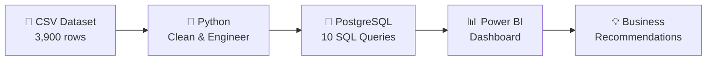

<div align="center">

# 🛍️ Customer Shopping Behavior Analysis

**End-to-end analytics project: Python cleaning → PostgreSQL analysis → Power BI dashboard**


</div>

---

## 📌 Overview

This project analyzes **3,900 customer purchases** across four product categories (Clothing, Accessories, Footwear, Outerwear) to uncover spending patterns, customer segments, product preferences, and subscription behavior, and to turn those findings into actionable business recommendations.

| Stage | Tool | What was done |
|-------|------|---------------|
| 1. Prepare | Python (pandas) | Cleaning, imputation, feature engineering |
| 2. Analyze | PostgreSQL | 10 business questions answered with SQL |
| 3. Visualize | Power BI | Interactive dashboard with slicers and KPIs |



---

## 📊 Dashboard


The dashboard includes:

- **Slicers:** Subscription Status, Gender, Category, Shipping Type
- **KPI cards:** 3.9K customers · $59.76 average purchase · 3.75 average review rating
- **Visuals:** subscription split, revenue and sales by category, revenue and sales by age group

---

## 🗂️ Dataset

| Property | Value |
|----------|-------|
| Rows | 3,900 |
| Columns | 18 |
| Missing values | 37 in `Review Rating` |
| Purchase amount range | $20 – $100 |
| Age range | 18 – 70 |

**Feature groups**

- **Customer demographics:** Age, Gender, Location, Subscription Status
- **Purchase details:** Item Purchased, Category, Purchase Amount (USD), Season, Size, Color
- **Shopping behavior:** Discount Applied, Promo Code Used, Previous Purchases, Frequency of Purchases, Review Rating, Shipping Type, Payment Method

---

## 🐍 Python: Data Preparation

1. **Load** the CSV with `pandas` and inspect it with `info()` and `describe()`.
2. **Impute** missing `Review Rating` values with the **median rating of each product category**.
3. **Standardize** column names to `snake_case` and rename `purchase_amount_(usd)` to `purchase_amount`.
4. **Engineer features**
   - `age_group`: quartile-based bins via `pd.qcut` (Young Adult, Adult, Middle Aged, Senior)
   - `purchase_frequency_days`: text frequency mapped to days between purchases
5. **Check consistency:** `discount_applied` and `promo_code_used` were identical, so `promo_code_used` was dropped.
6. **Load** the cleaned DataFrame into PostgreSQL (table `customer`) using SQLAlchemy.

---

## 🐘 SQL: Business Questions

| # | Question | Key result |
|---|----------|------------|
| 1 | Revenue by gender | Male $157,890 vs Female $75,191 |
| 2 | Discount users who spent at or above average | 839 customers |
| 3 | Top 5 products by average rating | Gloves (3.86), Sandals, Boots, Hat, Skirt |
| 4 | Standard vs Express shipping | $58.46 vs $60.48 average purchase |
| 5 | Subscribers vs non-subscribers | $59.49 vs $59.87 average spend |
| 6 | Most discount-dependent products | Hat (50.00%), Sneakers, Coat, Sweater, Pants |
| 7 | Customer segmentation | Loyal 3,116 · Returning 701 · New 83 |
| 8 | Top 3 products per category | e.g. Jewelry, Blouse, Sandals, Jacket lead their categories |
| 9 | Repeat buyers and subscriptions | 958 subscribers vs 2,518 non-subscribers with 5+ previous purchases |
| 10 | Revenue by age group | Young Adult $62,143 leads |

**Segment definitions (Q7):** New = 1 previous purchase · Returning = 2–10 · Loyal = 11 or more.

---

## 🔍 Key Insights

- 👥 **Male customers drive 67.7% of revenue**, mainly because they make up about 68% of customers. Spend per customer is nearly equal across genders.
- 🔔 **Subscribers don't spend more.** They are 27% of customers and about 27% of revenue, with almost identical average spend.
- 🚚 **Express shipping customers spend about $2 more** per purchase than Standard customers.
- 🏷️ **Roughly half of purchases of Hats, Sneakers, Coats, Sweaters and Pants use a discount.**
- 🧑‍🤝‍🧑 **80% of customers are already Loyal**, and only 83 are New, so acquisition is a growth opportunity.
- 🎂 **Young Adults and Middle Aged customers contribute about 52% of revenue.**
- 🛒 **Clothing is the top category** for both revenue and sales volume.

---

## 💡 Business Recommendations

1. **Boost subscriptions:** promote exclusive subscriber benefits to lift both sign-ups and spend.
2. **Loyalty programs:** reward repeat buyers to move Returning customers into the Loyal segment.
3. **Review discount policy:** balance sales boosts with margin control.
4. **Product positioning:** highlight top-rated and best-selling products in campaigns.
5. **Targeted marketing:** focus on high-revenue age groups and Express-shipping users.

---

## 🚀 How to Run

1. **Clone the repository**
   ```bash
   git clone https://github.com/<your-username>/<your-repo>.git
   cd <your-repo>
   ```
2. **Install dependencies**
   ```bash
   pip install pandas sqlalchemy psycopg2-binary
   ```
3. **Create the database** in PostgreSQL:
   ```sql
   CREATE DATABASE customer_behavior;
   ```
4. **Run the Python notebook** to clean the data and load it into the `customer` table. Update the connection details (username, password, host, port) for your own setup.
5. **Run the SQL queries** from `sql/analysis_queries.sql` in pgAdmin or `psql`.
6. **Open the `.pbix` file** in Power BI Desktop to explore the dashboard.

---


## 🛠️ Tech Stack

`Python` · `pandas` · `SQLAlchemy` · `psycopg2` · `PostgreSQL` · `Power BI`

---

<div align="center">

</div>
